# Nexo — tu agente DSH en el móvil

Una app móvil que habla con **DeepSeek Harness (DSH)** en tu PC: eliges un
proyecto, abres una conversación y trabajas con el agente desde el sofá, el tren
o la cama. Sincronizada de verdad con DSH: las mismas sesiones que ves en el
escritorio.

- 🏠 **Elige workspace**: navega las carpetas del PC desde el móvil.
- 💬 **Solo conversación**: ves las respuestas del agente, no tool calls ni ruido.
- 🧠 **Modelo por conversación**: DeepSeek Flash o V4 Pro, eliges en cada chat.
- 🖼️ **Imágenes y documentos**: fotos, PDF, DOCX, XLSX, TXT… el agente los abre y trabaja con ellos.
- 🎙️ **Dictado con dos motores**: el nativo del móvil o 100 % local en el PC.
- 🔔 **Avisos**: te notifica cuando termina una tarea larga.
- 🌍 **Funciona en cualquier red sin configurar nada**: el puente se publica por
  HTTPS y la app ya trae la dirección puesta.
- 🧭 **Consola de agente**: pantalla "Nexo" con estado de conexión y **registro
  de actividad** (duración, herramientas usadas y resultado de cada turno), más
  un **drawer de proyectos** para cambiar de canal sin volver atrás.
- 🔗 **Chat con contexto**: separadores de fecha/hora y tarjetas para abrir los
  enlaces que devuelve el agente.
- 🔄 **Sincronizado**: cada chat es una sesión real de DSH (`~/.dsh/sessions`),
  visible también en el escritorio.
- 🔒 **Privado**: PIN + token por dispositivo, sandbox `workspace-write`, y todo
  el historial se queda en tu PC.
- 📲 **APK de Android** firmado + PWA instalable para iPhone.

```
móvil (APK o PWA)  ──HTTPS/SSE──▶  puente Nexo  ──spawn──▶  dsh headless  ──▶  tus proyectos
                    cualquier red (Tailscale Funnel)         (sesiones compartidas con DSH)
```

## Así se ve

| Emparejar | Tus proyectos | Conversaciones | Solo lectura |
|---|---|---|---|
| 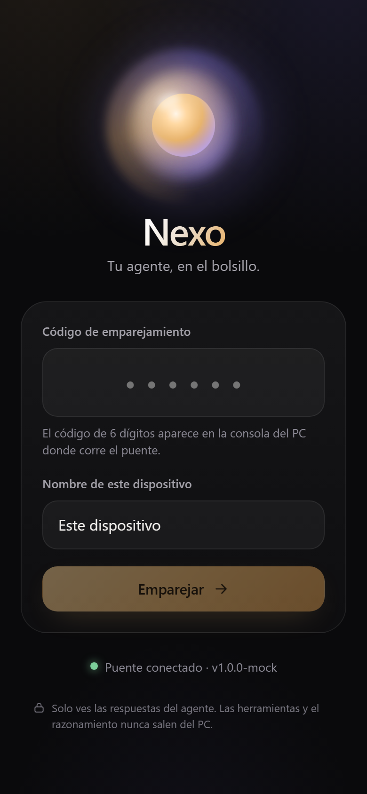 | 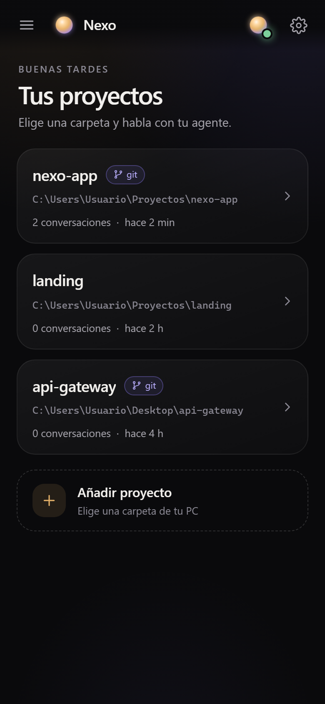 | 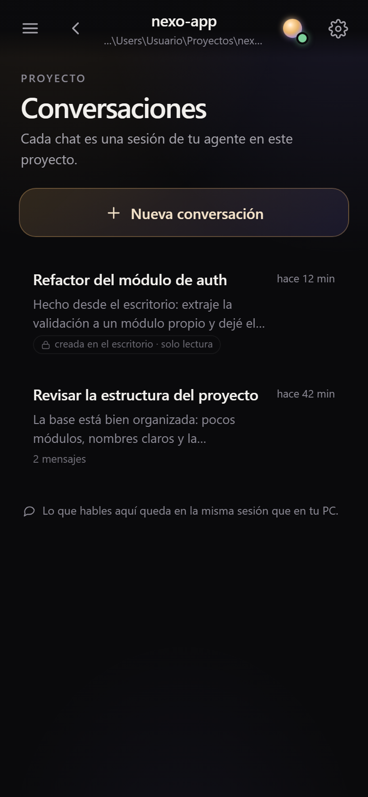 | 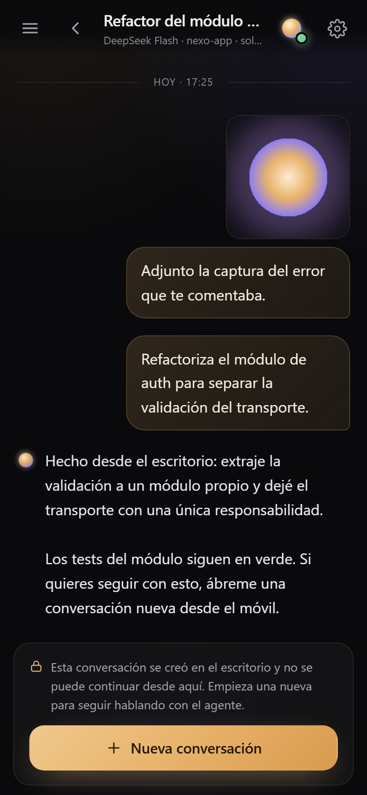 |

Las capturas están tomadas contra el puente real: las de la PWA en Chromium
headless a 390×844, y las del APK en un emulador Android 16.

| Modelo del chat | APK nativo | Documento adjunto |
|---|---|---|
| 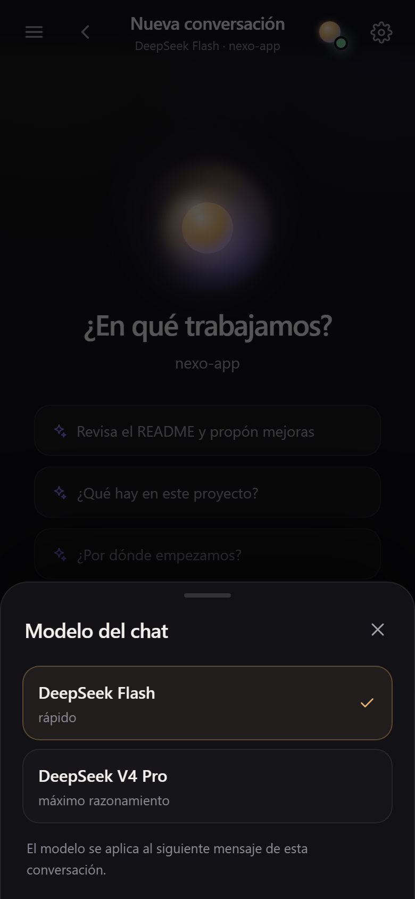 | 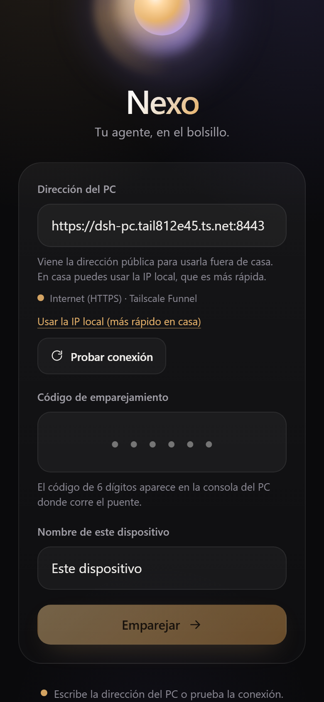 | 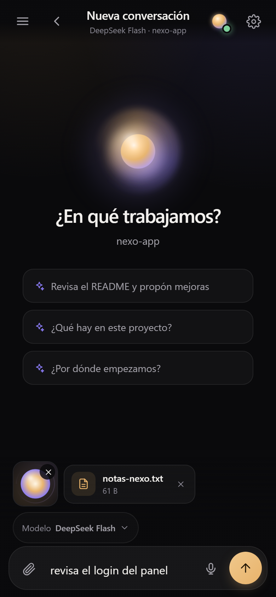 |

| Acceso desde cualquier red | Push con la app cerrada |
|---|---|
| 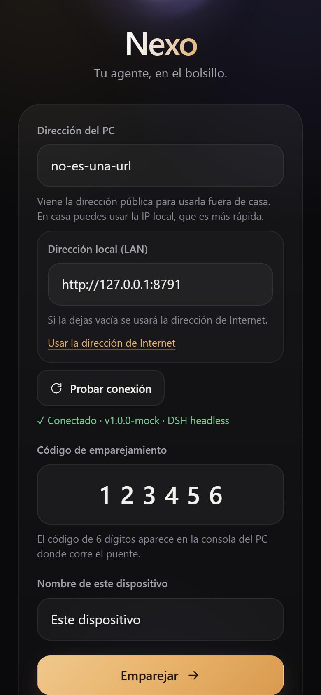 | 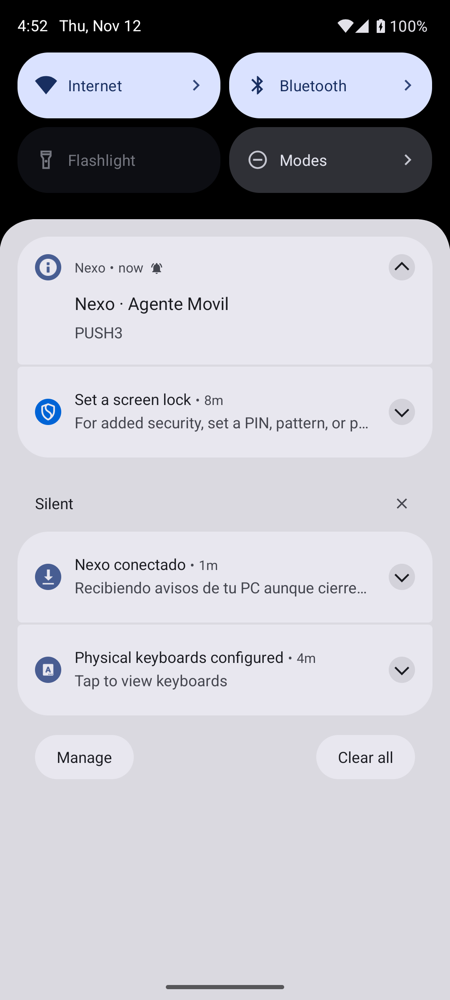 |

| Panel del agente | Drawer de proyectos | Enlaces y fechas en el chat |
|---|---|---|
| 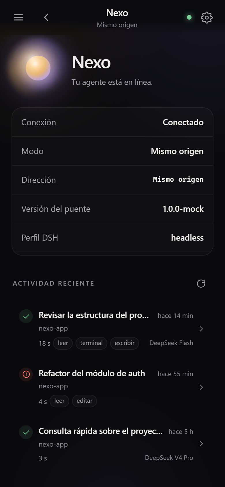 | 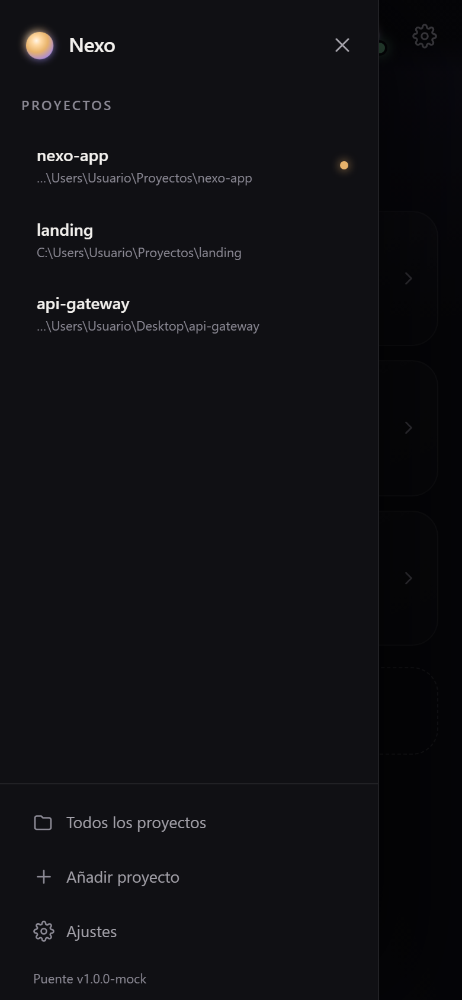 | 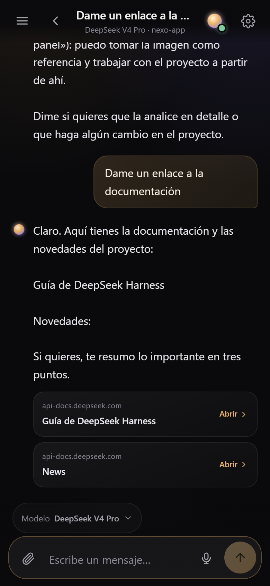 |

## Instalar en Android (APK)

El APK es una app nativa (WebView + plugins). **No pide nada al abrirlo**: entra
directo a tus proyectos. Lleva dentro el token del dispositivo y la dirección
pública del puente (aprovisionamiento), así que **no hay PIN, ni dirección, ni
emparejamiento**, y funciona en cualquier red (WiFi o datos móviles).

1. Copia `Nexo-1.0.0.apk` (en la raíz del proyecto) al móvil: cable, Google
   Drive, Telegram, lo que sea.
2. Ábrelo y permite *instalar apps de origen desconocido* para esa aplicación
   cuando el sistema lo pregunte.
3. Ábrelo: ya estás dentro.

La APK está firmada con el keystore del proyecto
(`apk/keystore/nexo-release.jks`). Para recompilarla:

```powershell
node scripts/provisionar.mjs "Nombre del móvil"   # token nuevo dentro de la build
cd app; npm run build
cd ..\apk; npm run apk
```

> El token va **dentro del APK**. Si pierdes el móvil, revoca el dispositivo en
> la app (Ajustes → dispositivos) y vuelve a aprovisionar. La pantalla de PIN
> sigue existiendo como respaldo para un móvil sin aprovisionar.

## Instalar en iPhone (o Android sin APK)

La PWA se instala desde el navegador sobre HTTPS. Abre la URL pública que imprime
el puente (`https://<equipo>.<tailnet>.ts.net:8443`) y:

- **Android/Chrome**: menú → *Instalar aplicación*.
- **iPhone/Safari**: Compartir → *Añadir a pantalla de inicio*.

> Sin HTTPS el navegador solo ofrece "crear acceso directo". Para eso está el APK.

## Arranque rápido

Requisitos: Windows con DSH instalado y Node.js 22+.

```powershell
# 1. Interfaz móvil (una sola vez)
cd app
npm install
npm run build

# 2. Puente
cd ..
scripts\iniciar.cmd
```

La consola muestra el PIN y las direcciones:

```
  PIN de emparejamiento:  123456

  ★ Desde cualquier red: https://equipo.tailnet.ts.net:8443
    (Tailscale Funnel · HTTPS válido · sin instalar nada en el móvil)

  En este PC:   http://127.0.0.1:8790
  En tu WiFi:   http://192.168.0.202:8790
  Tailscale:    http://100.76.119.50:8790
```

3. En el móvil: instala el APK (ver arriba) o abre la URL pública, introduce el
   PIN y listo.

## Fuera de casa (sin configurar nada)

El puente se publica automáticamente con **Tailscale Funnel** en una URL HTTPS
estable (`https://<equipo>.<tailnet>.ts.net:8443`). El móvil **no necesita
Tailscale**: le llega con la app, en cualquier red, con datos móviles incluidos.

- Se activa solo al arrancar el puente (`remoteAccess: true` en
  `server/data/config.json`).
- Para desactivarlo: `"remoteAccess": false` y reinicia (sigue funcionando en la
  WiFi de casa y por Tailscale).
- **Qué implica**: el puerto queda expuesto a Internet. Está protegido por PIN
  con bloqueo global (25 fallos en 15 min cierran el emparejamiento) y tokens de
  dispositivo de 256 bits; todo va por HTTPS. Aun así, si no lo necesitas, apágalo.

> Alternativa: con Tailscale instalado en el móvil puedes usar la URL
> `https://<equipo>.<tailnet>.ts.net:8443` sin exponerla a Internet; y con
> `scripts\tunel-cloudflare.ps1` tienes un túnel temporal de Cloudflare.

> **Alternativa sin Tailscale para la PWA**: `scripts\tunel-cloudflare.ps1`
> publica una URL `https://…trycloudflare.com` temporal (cambia en cada arranque
> y es pública: protégela con el PIN y no la dejes abierta).
> Con el APK no hace falta nada de esto si el móvil está en tu misma WiFi.

## Modelos, adjuntos, voz y avisos

- **Modelo por conversación**: al empezar un chat eliges *DeepSeek Flash*
  (rápido, por defecto) o *DeepSeek V4 Pro* (máximo razonamiento). Se puede
  cambiar en cualquier momento y queda guardado por chat. El puente lo aplica
  con un overlay `--patch` del perfil `headless`, porque `dsh headless` no tiene
  flag `--model`.
- **Imágenes y documentos**: el clip del compositor abre galería, cámara o
  archivos (PDF, DOCX, XLSX, TXT, CSV, JSON…). Se sube al puente y se guarda en
  `<proyecto>/.nexo/adjuntos/` (dentro del workspace, porque el sandbox del
  agente no puede leer fuera de él). El agente recibe `[Adjunto: <ruta>]` y lo
  abre con sus herramientas: `read_image` para fotos, y para documentos ya se
  apaña él solo (verificado leyendo un DOCX y un PDF reales).
  Límites: 8 MB imágenes, 25 MB documentos; ejecutables y scripts se rechazan.
- **Dictado**, dos motores en Ajustes:
  - *Nativo del móvil* (por defecto): reconocedor de Android / navegador.
  - *En el PC (sin internet)*: el móvil graba WAV mono 16 kHz, lo manda al
    puente y el PC transcribe en local. Se instala con
    `scripts\instalar-voz.ps1`; el estado se ve en `doctor`.
  El texto se escribe en el compositor, nunca se envía solo.
- **Avisos de tareas largas (push real, sin FCM)**: el APK instala un
  **servicio en primer plano** que mantiene un canal propio con el puente
  (`long-poll` a `/api/push`). Cuando termina una tarea de más de ~8 s te avisa
  **aunque la app esté cerrada**; si estás mirando la app no molesta. No usa
  Firebase ni cuenta de Google: el aviso viaja por tu propio túnel HTTPS.
  Coste: una notificación fija "Nexo conectado" (obligatoria en Android para
  servicios en primer plano) y consumo de batería mínimo. Se para solo si
  cierras sesión en la app o desinstalas.
  **Aviso honesto**: si Android te obliga a *forzar la detención* de la app, el
  servicio muere con ella (comportamiento del sistema); al volver a abrirla se
  reinicia.

## Arranque automático

```powershell
scripts\instalar-arranque.ps1    # arranca al iniciar sesión, sin ventana
scripts\desinstalar-arranque.ps1
```

## Seguridad (leer esto)

El puente puede **ejecutar órdenes y editar archivos** en tu PC: es una puerta
de entrada real. Por eso:

- El PIN solo se muestra en la consola del PC, nunca por HTTP.
- Cada móvil recibe un token propio de 256 bits, guardado con hash y revocable
  (`Configuración → dispositivos` en la app).
- El agente corre con sandbox `workspace-write`: solo escribe dentro del
  proyecto elegido. Se puede endurecer a `read-only` en
  `server/data/config.json` (`"trustMode": "read-only"`).
- Con `remoteAccess` el puente queda expuesto a Internet por Tailscale Funnel,
  pero **nunca se abre un puerto en el router**: el tráfico entra por la
  conexión saliente de Tailscale, con HTTPS y certificado válido.
- El emparejamiento tiene bloqueo global: 25 fallos en 15 minutos lo cierran
  temporalmente y avisan en el log.
- Solo se aceptan archivos de imagen y documento; ejecutables y scripts se
  rechazan en el servidor.
- Si sospechas, rota el PIN (`node server/src/index.js rotate-pin`), revoca los
  dispositivos y pon `"remoteAccess": false`.

## Comandos útiles

```powershell
node server/src/index.js doctor          # DSH, credencial, build, acceso remoto y dictado
node server/src/index.js pin             # muestra el PIN actual
node server/src/index.js rotate-pin      # nuevo PIN
node scripts/smoke.mjs                   # prueba E2E contra el puente real
scripts\instalar-voz.ps1                 # dictado local en el PC (opcional)
cd server; npm test                      # tests del puente y del lector de sesiones
```

## Desarrollo

```powershell
cd app
npm run dev        # Vite en :5173 con proxy a :8790 (necesita el puente arrancado)
npm run mock       # mock del contrato en :8791, PIN 123456, sin DSH
npm run smoke      # comprobaciones del contrato contra el mock
npm run build      # genera app/dist, que el puente sirve en /

cd ..\apk          # empaquetado Android
npx cap sync android
npx cap open android   # opcional: abre Android Studio
npm run apk            # APK de release firmado en android/app/build/outputs/apk/release/
```

El APK se firma con `apk/keystore/nexo-release.jks` (credenciales en
`apk/keystore.properties`, fuera de git). El contrato entre app y puente está en
[`docs/API.md`](docs/API.md) y las decisiones de arquitectura en
[`docs/ARCHITECTURE.md`](docs/ARCHITECTURE.md).

## Limitaciones conocidas

- **Los chats creados en el escritorio no se pueden adoptar tal cual.** DSH marca
  esas sesiones con un *agent preset* y su runner de un solo turno se niega a
  componerlos (`assertAdoptable()` en `@deepseek-ai/dsh-headless`). Nexo los
  muestra completos y, si escribes en ellos, **abre una conversación nueva con su
  contexto** (`POST /api/chats/:id/fork`) para que sigas donde lo dejaste sin
  perder el hilo. Los chats creados desde el móvil se continúan directamente.
- Cada mensaje arranca un proceso `dsh` (~1–2 s hasta la primera palabra).
- Un turno a la vez por conversación; hasta 3 en paralelo en total.
- El modelo se elige por conversación, pero dentro del perfil `headless` de DSH
  (los modelos disponibles están en `server/data/config.json`).
- Las imágenes se guardan en `<proyecto>/.nexo/adjuntos/`; puedes borrar esa
  carpeta cuando quieras (las miniaturas del historial dejarán de verse).
- El APK aprovisionado lleva el token dentro: trátalo como una llave. Revócalo
  desde Ajustes si pierdes el móvil.

## Estructura

| Ruta | Qué es |
|---|---|
| `app/` | PWA (React + Vite + TypeScript) + mock del contrato |
| `apk/` | Empaquetado Android con Capacitor, iconos y keystore |
| `scripts/provisionar.mjs` | Hornea token + URL en la app y deja lista la APK sin PIN |
| `apk/android/app/src/main/java/…/NexoPushService.java` | Servicio en primer plano del push propio |
| `server/` | Puente: auth, workspaces, modelos, subidas, actividad, SSE, estáticos |
| `server/src/dsh-sessions.js` | Lector del almacén de sesiones de DSH (zstd multiframe) |
| `scripts/` | Arranque, firewall, túnel, Tailscale HTTPS, autostart, smoke |
| `docs/API.md` | Contrato entre app y puente |
| `docs/ARCHITECTURE.md` | Decisiones y por qué |
| `docs/capturas/` | Capturas reales de la app |

## Cómo funciona un turno

1. La app manda el texto a `POST /api/workspaces/:id/messages`.
2. El puente lanza `dsh headless --json` con `cwd` = carpeta del proyecto.
3. Los eventos NDJSON (`thinking`, `tool_call`, `text`, `final`) se traducen a
   SSE (`delta`, `tool`, `turn_end`) y llegan al móvil en tiempo real.
4. La sesión queda guardada en el almacén de DSH → aparece en el escritorio.

## Problemas frecuentes

| Síntoma | Causa / solución |
|---|---|
| El móvil no abre la URL | Firewall de Windows (ver arriba) o redes distintas |
| "Código incorrecto" siempre | PIN caducado por reinicio del puente: míralo en la consola o `node server/src/index.js pin` |
| La respuesta tarda 2-3 s en empezar | Normal: cada turno arranca un proceso `dsh` (~1-2 s) |
| `MISSING_CREDENTIAL` en la app | Falta `DEEPSEEK_API_KEY`; ejecuta `doctor` |
| "El puerto 8790 ya está ocupado" | Cierra otra instancia o cambia `port` en `server/data/config.json` |
